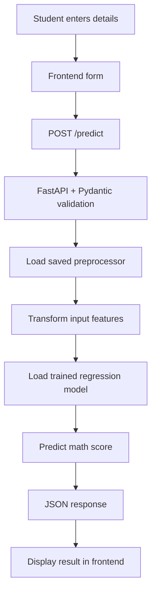
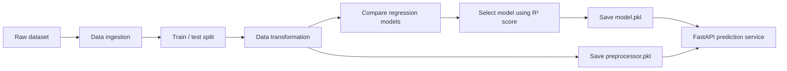

<div align="center">

# 🎓 Student Performance AI
### End-to-End Machine Learning Deployment Project

Predict a student's mathematics score from demographic details and reading/writing scores using a trained regression model served through FastAPI.

[](https://ml-deployment-project-3frontend.onrender.com)
[](https://github.com/bikram-parth/ML_Deployment_project)
[](https://www.python.org/)
[](https://fastapi.tiangolo.com/)
[](https://render.com/)

**[Open the live application](https://ml-deployment-project-3frontend.onrender.com)** · **[Explore the repository](https://github.com/bikram-parth/ML_Deployment_project)**

</div>

---

## 📌 Table of Contents

- [Overview](#-overview)
- [Live Demo](#-live-demo)
- [Features](#-features)
- [How It Works](#-how-it-works)
- [Tech Stack](#️-tech-stack)
- [Project Structure](#-project-structure)
- [API Reference](#-api-reference)
- [Run Locally](#-run-locally)
- [Deployment](#-deployment)
- [Limitations](#️-limitations)
- [Future Improvements](#-future-improvements)
- [Author](#-author)

<details>
<summary><strong>📖 Project overview — click to expand</strong></summary>

This project demonstrates an end-to-end machine learning workflow: data ingestion, preprocessing, model comparison, saving trained artifacts, and exposing predictions through a REST API.

The application estimates a student's **math score (0–100)** using these inputs:

- Gender
- Race / ethnicity group
- Parent's level of education
- Lunch category
- Test-preparation course status
- Reading score (0–100)
- Writing score (0–100)

The model's output is a statistical estimate learned from historical training data. It should not be treated as a definitive measure of a student's ability or future.

</details>

## 🚀 Live Demo

### [Try Student Performance AI →](https://ml-deployment-project-3frontend.onrender.com)

Open the deployed frontend, enter the requested student details, and submit the form to request a prediction.

> **Deployment note:** A page loading successfully does not necessarily mean the prediction API is reachable. If the form reports an error, check the backend service status, its configured URL in the frontend JavaScript, and the browser's Network/Console panels.

## ✨ Features

- **Interactive web form** for student details and reading/writing scores.
- **Regression-based prediction** of a math score.
- **Input validation** using Pydantic, including allowed categorical values and score bounds.
- **Reusable preprocessing artifact** to transform inputs consistently with model training.
- **Modular ML workflow** with separate data-ingestion, transformation, and model-training components.
- **Model comparison** across Linear Regression, K-Nearest Neighbors, AdaBoost, Gradient Boosting, and XGBoost regressors.
- **REST API** built with FastAPI.
- **Cloud deployment** with a separately hosted frontend and backend.

## 🔄 How It Works



### Model development workflow



<details>
<summary><strong>🧠 Models evaluated</strong></summary>

The model-training component evaluates these regressors:

| Model | Purpose |
|---|---|
| Linear Regression | Baseline linear regression |
| K-Nearest Neighbors Regressor | Predict from nearby training examples |
| AdaBoost Regressor | Boosting-based regression |
| Gradient Boosting Regressor | Sequential boosting of decision trees |
| XGBoost Regressor | Gradient-boosted tree model |

The current training code ranks models by the R² score returned by its training/evaluation helper and saves the selected model to `artifacts/model.pkl`.

**Metrics:** Add the measured test-set R², MAE, and RMSE here after confirming them from your actual training logs. Do not report an unverified score as model performance.

</details>

## 🛠️ Tech Stack

| Technology | Role |
|---|---|
| Python | Main programming language |
| Pandas / NumPy | Tabular data handling and numerical operations |
| Scikit-learn | Preprocessing, regression models, evaluation |
| XGBoost | Gradient-boosting regressor |
| Joblib | Loading and saving model artifacts |
| FastAPI | REST API and prediction endpoint |
| Pydantic | Request schema and input validation |
| HTML / CSS / JavaScript | Frontend form and API interaction |
| GitHub | Source control |
| Render | Frontend/backend hosting |

## 📂 Project Structure

```text
ML_Deployment_project/
├── artifacts/
│   ├── model.pkl                 # Trained regression model
│   └── preprocessor.pkl          # Fitted preprocessing object
├── src/
│   ├── components/
│   │   ├── data_ingestion.py     # Load data and create train/test data
│   │   ├── data_transformation.py# Preprocessing and feature transformation
│   │   └── model_trainer.py      # Train, compare, and save regressors
│   ├── templates/
│   │   ├── app.py                # FastAPI application
│   │   └── index.html            # Web frontend
│   ├── exception.py              # Custom exception handling
│   ├── logger.py                 # Logging utilities
│   └── utils.py                  # Reusable helper functions
├── requirements.txt              # Python dependencies
├── setup.py                      # Package configuration
└── README.md
```

> The tree above summarizes the main files and artifacts. If you add or rename files, update this section to match the repository.

## 🔌 API Reference

### `POST /predict`

Accepts student features as JSON and returns the predicted math score.

**Request body**

```json
{
  "gender": "female",
  "race_ethnicity": "group B",
  "parental_level_of_education": "bachelor's degree",
  "lunch": "standard",
  "test_preparation_course": "completed",
  "reading_score": 78,
  "writing_score": 82
}
```

**Example response**

```json
{
  "math_score": 79.4
}
```

The score above is an **illustrative response format**, not a guaranteed output for the example input.

**Validation rules**

- `gender`: `female` or `male`
- `race_ethnicity`: `group A`, `group B`, `group C`, `group D`, or `group E`
- `parental_level_of_education`: `bachelor's degree`, `some college`, `master's degree`, `associate's degree`, `high school`, or `some high school`
- `lunch`: `standard` or `free/reduced`
- `test_preparation_course`: `none` or `completed`
- `reading_score` and `writing_score`: integers from `0` to `100`

### Interactive API documentation

When the backend is running, FastAPI normally exposes Swagger UI at `/docs` and OpenAPI JSON at `/openapi.json`.

Replace `<BACKEND_URL>` with your actual deployed **backend** URL:

- Swagger UI: `<BACKEND_URL>/docs`
- Health/root route: `<BACKEND_URL>/`

The frontend URL is a separate service; do not use it as the backend URL unless both are actually served by the same FastAPI application.

## 💻 Run Locally

### 1. Clone the repository

```bash
git clone https://github.com/bikram-parth/ML_Deployment_project.git
cd ML_Deployment_project
```

### 2. Create and activate a virtual environment

**Windows CMD**

```bat
python -m venv .venv
.venv\Scripts\activate.bat
```

**macOS / Linux**

```bash
python3 -m venv .venv
source .venv/bin/activate
```

### 3. Install dependencies

```bash
python -m pip install --upgrade pip
pip install -r requirements.txt
```

### 4. Start the FastAPI backend

From the repository root, run:

```bash
uvicorn src.templates.app:app --reload
```

Open [http://127.0.0.1:8000/docs](http://127.0.0.1:8000/docs) to inspect and test the API.

> The application loads `artifacts/model.pkl` and `artifacts/preprocessor.pkl` when the FastAPI module starts. Ensure both files exist and are compatible with the installed versions of their dependencies.

### 5. Open the frontend

Open `src/templates/index.html` in your browser or serve the `src/templates` directory using a local static server. Ensure the frontend JavaScript sends requests to the backend address, for example `http://127.0.0.1:8000/predict`, when testing locally.

If browser requests are blocked, verify CORS settings and the URL configured in the frontend JavaScript.

## ☁️ Deployment

This project uses Render for hosting. A common split deployment is:

1. **Backend — Render Web Service**
   - Build command: `pip install -r requirements.txt`
   - Start command: `uvicorn src.templates.app:app --host 0.0.0.0 --port $PORT`
   - Confirm the service's environment and artifact files are correct.

2. **Frontend — Render Static Site**
   - Publish directory: `src/templates` (if `index.html` is directly inside this directory).
   - No build command is needed for plain HTML/CSS/JavaScript.
   - Configure the frontend API URL to point to the deployed backend's `/predict` endpoint.

3. **CORS and connectivity**
   - Allow the frontend origin in the backend CORS configuration.
   - Check the browser Network tab and backend logs if predictions fail.
   - Test the backend `/docs` page and send a valid request to `/predict`.

4. **Continuous deployment**
   - When a connected GitHub branch is updated, Render can automatically deploy new commits according to the service's auto-deploy settings.

## ⚠️ Limitations

- Predictions depend on the quality and representativeness of the training data.
- A predicted score is an estimate, not a guarantee of a student's result.
- The model should not be used as the sole basis for educational decisions.
- Performance metrics should be added only after they are confirmed on held-out test data.
- Keep the model and preprocessing artifact versions aligned.

## 🔮 Future Improvements

- [ ] Add a dedicated health-check endpoint.
- [ ] Add automated tests for preprocessing and `/predict`.
- [ ] Add CI checks for formatting, linting, and tests.
- [ ] Track experiments and model versions with MLflow.
- [ ] Add verified test-set metrics and a model comparison report.
- [ ] Restrict CORS to the production frontend origin.
- [ ] Add API error handling and clearer frontend connection messages.
- [ ] Add screenshots or a short demo GIF of the working application.

## 👨‍💻 Author

**Bikram Debnath**

- GitHub: [@bikram-parth](https://github.com/bikram-parth)
- Project repository: [ML_Deployment_project](https://github.com/bikram-parth/ML_Deployment_project)
- Live application: [Student Performance AI](https://ml-deployment-project-3frontend.onrender.com)

---

<div align="center">

If you find this project useful, consider giving the repository a ⭐ on GitHub.

**Built to demonstrate an end-to-end machine learning workflow — from training to deployment.**

</div>
